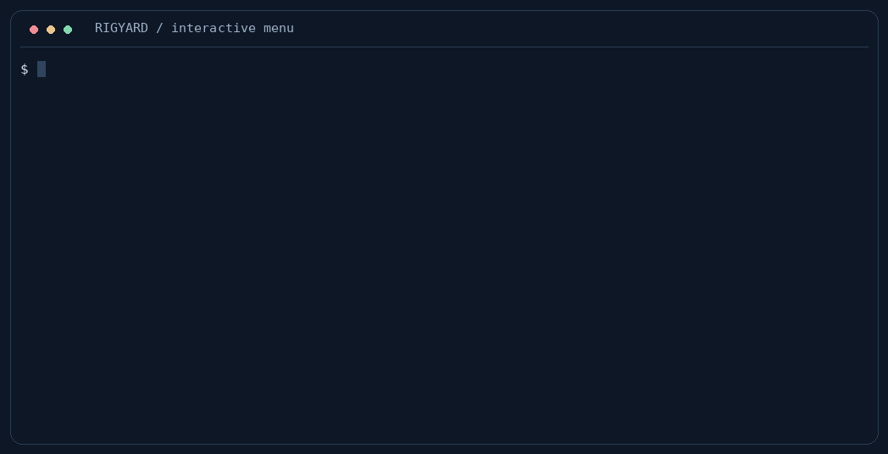

# 

A configuration-driven CLI for containerized robotics development. Define your workflow in YAML,
then build images, manage containers, run builds and tests, and debug multi-process systems from
one command or interactive menu.



The GIF shows the real interactive menu after running `rigyard`. See
[recording notes](docs/development/demo.md).

## Features

- Build layered images from ordered Dockerfile fragments.
- Create development containers with lifecycle hooks.
- Run project builds, tests, and custom tasks inside containers.
- Debug multi-process scenarios with tmux using existing containers or Docker Compose.
- Register existing scenarios for systemd boot startup.
- Reuse configuration with variables, string templates, and interactive runtime values.
- Bind workspaces and use project command aliases.

## Installation

Requires **Python 3.10+**. Container operations require Docker; scenarios also require tmux and,
when configured, Docker Compose v2. Boot startup requires Linux with systemd.

### From PyPI

```bash
python -m pip install rigyard
```

### From source

```bash
git clone https://github.com/zz990099/Rigyard.git
cd Rigyard
python -m pip install .
```

Verify with `rigyard --version`. See [installation and requirements](https://github.com/zz990099/Rigyard/blob/main/docs/installation.md)
for feature dependencies, or [contributing](https://github.com/zz990099/Rigyard/blob/main/CONTRIBUTING.md) for development.

## Quick start

Run these commands from a source checkout to explore the example without Docker:

```bash
cd examples/robot-development
rigyard validate
rigyard
```

Preview a scenario without starting containers:

```bash
rigyard scene start nav2-tb3 --dry-run --non-interactive
```

For your own project, Rigyard reads `rigyard.yaml` in the current directory. Pass
`--config path/to/rigyard.yaml` to select another manifest, or bind a workspace with
`rigyard init -f path/to/rigyard.yaml`.

See [Getting started](https://github.com/zz990099/Rigyard/blob/main/docs/getting-started.md) for
configuration examples, plan previews, and project command aliases.

## Documentation

- [Getting started](https://github.com/zz990099/Rigyard/blob/main/docs/getting-started.md)
- [Installation and requirements](https://github.com/zz990099/Rigyard/blob/main/docs/installation.md)
- [Configuration overview](https://github.com/zz990099/Rigyard/blob/main/docs/configuration/index.md)
- [Global variables and string templates](https://github.com/zz990099/Rigyard/blob/main/docs/configuration/templates.md)
- [Runtime values](https://github.com/zz990099/Rigyard/blob/main/docs/configuration/runtime-values.md)
- [Images](https://github.com/zz990099/Rigyard/blob/main/docs/features/images.md)
- [Containers](https://github.com/zz990099/Rigyard/blob/main/docs/features/containers.md)
- [Project builds](https://github.com/zz990099/Rigyard/blob/main/docs/features/builds.md)
- [Tests](https://github.com/zz990099/Rigyard/blob/main/docs/features/tests.md)
- [Custom tasks](https://github.com/zz990099/Rigyard/blob/main/docs/features/tasks.md)
- [Scenarios](https://github.com/zz990099/Rigyard/blob/main/docs/features/scenarios.md)
- [CLI reference](https://github.com/zz990099/Rigyard/blob/main/docs/reference/cli.md)
- [Configuration schema reference](https://github.com/zz990099/Rigyard/blob/main/docs/reference/configuration-schema.md)
- [Exit codes](https://github.com/zz990099/Rigyard/blob/main/docs/reference/exit-codes.md)

Start with the [`minimal`](examples/minimal/) example or the small
[`robot-development`](examples/robot-development/) workspace for ROS Jazzy and Nav2 TB3 simulation.

## License

[MIT](https://github.com/zz990099/Rigyard/blob/main/LICENSE)

---

Powered by **Codex** — AI-assisted development and documentation.
